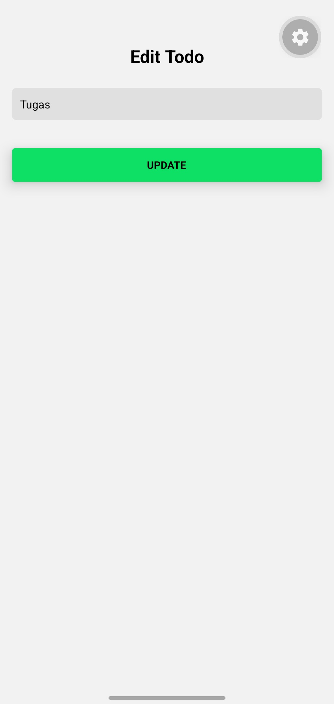
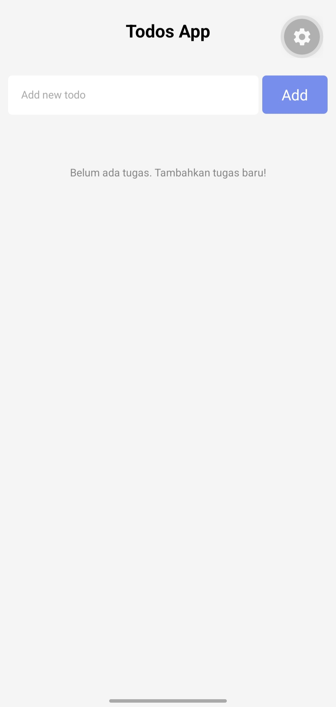

# 📝 TodosApp

### Catat tugas, selesaikan satu per satu! ✅

**TodosApp** adalah aplikasi manajemen tugas sederhana yang membantu pengguna mencatat, mengelola, dan memantau daftar aktivitas sehari-hari. Dibangun menggunakan **React Native**, **Expo**, **React Navigation**, dan **Firebase Cloud Firestore**, aplikasi ini memungkinkan pengguna menambahkan, mengubah, serta menghapus tugas dengan mudah.

Dengan tampilan yang sederhana dan sinkronisasi data secara real-time, TodosApp membantu aktivitas pengelolaan tugas menjadi lebih praktis dan terorganisir.

## ✨ Fitur Utama

- 📋 **Daftar Tugas** — Menampilkan seluruh tugas, dengan tugas terbaru berada di urutan teratas.
- ➕ **Tambah Tugas** — Menambahkan tugas baru dengan validasi agar input tidak kosong.
- ✏️ **Edit Tugas** — Mengubah nama tugas melalui halaman detail.
- 🗑️ **Hapus Tugas** — Menghapus tugas dengan konfirmasi sebelum data dihapus.
- 🔄 **Real-time Synchronization** — Memperbarui daftar secara otomatis melalui Firebase Cloud Firestore.
- 💬 **Empty State** — Menampilkan informasi ketika belum ada tugas.
- ⚠️ **Notifikasi** — Memberikan pemberitahuan ketika operasi berhasil atau mengalami kesalahan.

## 🛠️ Teknologi yang Digunakan

| Teknologi | Versi / Fungsi |
|---|---|
| JavaScript | Bahasa pemrograman |
| React Native | 0.88.1 |
| React | 19.3.0 |
| Expo SDK | ~58.0.23 |
| React Navigation | Navigasi antarhalaman menggunakan Stack |
| Firebase | ^13.2.0 |
| Cloud Firestore | Database NoSQL dan sinkronisasi real-time |
| @expo/vector-icons | Ikon antarmuka |
| react-native-safe-area-context | Pengelolaan area aman perangkat |

*Versi teknologi mengikuti deklarasi dependensi pada `package.json`.*

## 🗄️ Penyimpanan Data

TodosApp menggunakan **Firebase Cloud Firestore** sebagai tempat penyimpanan data tugas.

Data tugas disimpan dalam collection bernama `todos` dengan struktur berikut:

| Field | Keterangan |
|---|---|
| `heading` | Nama atau isi tugas |
| `createdAt` | Waktu pembuatan tugas |

Aplikasi memanfaatkan listener real-time untuk menerima perubahan data secara otomatis. Selain membaca data, aplikasi juga mendukung operasi tambah, ubah, dan hapus data.

## 📁 Struktur Proyek

```text
TodosApp/
├── assets/
│   ├── android-icon-background.png
│   ├── android-icon-foreground.png
│   ├── android-icon-monochrome.png
│   ├── favicon.png
│   ├── icon.png
│   └── splash-icon.png
├── Screens/
│   ├── Detail.js
│   └── Home.js
├── screenshots/
│   ├── home.jpg
│   ├── edit.jpg
│   └── empty-state.jpg
├── App.js
├── app.json
├── config.js
├── index.js
├── package.json
├── package-lock.json
├── LICENSE
└── README.md
```

### Penjelasan File Penting

- `App.js` — Mengatur navigasi Stack antara halaman Home dan Detail.
- `Screens/Home.js` — Mengelola daftar tugas, penambahan, penghapusan, dan navigasi.
- `Screens/Detail.js` — Menangani proses pengubahan nama tugas.
- `config.js` — Menginisialisasi Firebase dan koneksi Firestore.
- `index.js` — Menjadi titik masuk aplikasi Expo.
- `app.json` — Menyimpan konfigurasi aplikasi Expo.
- `assets/` — Menyimpan ikon dan aset visual aplikasi.
- `screenshots/` — Menyimpan dokumentasi tampilan aplikasi.

## 🚀 Persyaratan dan Instalasi

Sebelum menjalankan aplikasi, pastikan perangkat pengembangan sudah memiliki:

- Node.js dan npm.
- Akses ke proyek Firebase.
- Firebase Cloud Firestore yang sudah disiapkan.
- Perangkat atau emulator yang mendukung lingkungan Expo.

### 1. Clone Repository

```bash
git clone https://github.com/melisanrhkm/TodosApp.git
```

### 2. Masuk ke Folder Proyek

```bash
cd TodosApp
```

### 3. Install Dependencies

```bash
npm install
```

### 4. Konfigurasi Firebase

Buka file `config.js`, kemudian sesuaikan konfigurasi Firebase menggunakan konfigurasi dari proyek Firebase milik sendiri.

Pastikan Cloud Firestore sudah diaktifkan dan aturan keamanannya telah disesuaikan dengan kebutuhan aplikasi.

### 5. Jalankan Aplikasi

```bash
npm start
```

Perintah tambahan yang tersedia:

```bash
npm run android
npm run ios
npm run web
```

*Keberhasilan menjalankan aplikasi pada setiap platform bergantung pada konfigurasi dan lingkungan pengembangan yang digunakan.*

## 📱 Cara Menggunakan Aplikasi

1. Buka aplikasi TodosApp untuk melihat daftar tugas.
2. Masukkan nama tugas pada kolom **Add new todo**.
3. Tekan tombol **Add** untuk menyimpan tugas.
4. Pilih salah satu tugas untuk membuka halaman **Edit Todo**.
5. Ubah nama tugas, kemudian tekan tombol **UPDATE**.
6. Untuk menghapus tugas, tekan ikon hapus dan konfirmasikan tindakan.
7. Perubahan data akan diperbarui secara otomatis melalui Firestore.

## 📸 Screenshot Aplikasi

Berikut beberapa tampilan dari aplikasi TodosApp:

### Halaman Home
Menampilkan daftar tugas dan fitur untuk menambahkan tugas baru.


### Halaman Edit Todo
Memungkinkan pengguna mengubah nama tugas yang sudah dibuat.



### Halaman Empty State
Menampilkan kondisi ketika belum terdapat tugas yang tersimpan.



## 📄 Lisensi

Proyek **TodosApp** menggunakan lisensi **MIT License** untuk source code aplikasi yang dibuat dalam proyek ini.

Lisensi MIT memberikan izin kepada pengguna untuk menggunakan, menyalin, memodifikasi, menggabungkan, menerbitkan, mendistribusikan, dan menggunakan perangkat lunak ini, dengan tetap menyertakan pemberitahuan hak cipta dan teks lisensi.

Lihat file [LICENSE](LICENSE) untuk informasi lengkap mengenai ketentuan lisensi.

## 💡 Penutup

TodosApp dikembangkan sebagai proyek aplikasi mobile untuk menerapkan penggunaan React Native, pengelolaan navigasi, serta integrasi database berbasis Firebase Cloud Firestore.

Melalui aplikasi ini, diharapkan pengguna dapat mengelola aktivitas sehari-hari dengan lebih mudah, praktis, dan terorganisir.

Terima kasih telah mengunjungi repository **TodosApp**! Semoga proyek ini dapat bermanfaat sebagai referensi dan menjadi dasar untuk pengembangan aplikasi yang lebih baik ke depannya.

**Happy organizing, one task at a time! 🚀**
