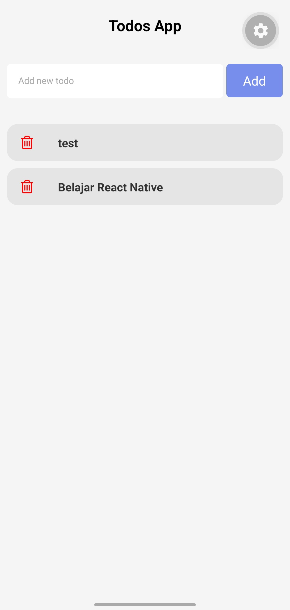

# TodosApp

### Catat tugas, bereskan satu per satu! ✅

Halo! 👋 **TodosApp** adalah aplikasi daftar tugas yang dibuat dengan **React Native**, **Expo**, **React Navigation**, dan **Firebase Cloud Firestore**. Tambahkan tugas baru, ubah namanya, atau hapus tugas yang sudah tidak diperlukan.


## Fitur

Kelola tugas langsung dari aplikasi:

- 📋 Lihat daftar tugas; tugas terbaru tampil lebih dahulu.
- ➕ Tambahkan tugas. Teks kosong atau hanya spasi tidak diterima.
- ✏️ Ubah nama tugas dari layar detail; nama tidak boleh kosong.
- 🗑️ Hapus tugas setelah konfirmasi.
- 🔄 Lihat pembaruan daftar secara real-time dari Firestore.
- 💬 Lihat pesan ketika daftar masih kosong. Penghapusan dan pembaruan menampilkan pemberitahuan keberhasilan; kesalahan operasi menampilkan pemberitahuan kesalahan.

## Teknologi

| Teknologi | Versi atau fungsi |
| --- | --- |
| JavaScript | Bahasa yang digunakan pada file aplikasi |
| React Native | `0.88.1` |
| React | `19.3.0` |
| Expo SDK | `~58.0.23` |
| React Navigation | Navigasi layar dengan stack |
| Firebase | `^13.2.0`; Cloud Firestore melalui API compat |
| `@expo/vector-icons` | Ikon pada antarmuka |
| `react-native-safe-area-context` | Pengelolaan area aman perangkat |

Versi mengikuti deklarasi dependensi di `package.json`.

## Penyimpanan Data

Tugas disimpan di Firebase Cloud Firestore, pada collection `todos`.

| Field | Kegunaan |
| --- | --- |
| `heading` | Nama atau teks tugas |
| `createdAt` | Waktu pembuatan; dipakai untuk mengurutkan daftar |

Data dibaca melalui listener real-time. Aplikasi juga bisa menambahkan, memperbarui, dan menghapus dokumen pada collection tersebut.

## Struktur Proyek

```text
.
├── .gitignore
├── AGENTS.md
├── App.js
├── app.json
├── config.js
├── index.js
├── LICENSE
├── package.json
├── package-lock.json
├── README.md
├── Screens/
│   ├── Detail.js
│   └── Home.js
└── assets/
    ├── android-icon-background.png
    ├── android-icon-foreground.png
    ├── android-icon-monochrome.png
    ├── favicon.png
    ├── icon.png
    └── splash-icon.png
```

Folder `.expo/` dan `node_modules/` tidak dicantumkan karena merupakan folder lokal atau dependensi yang diabaikan Git.

Kalau ingin menjelajahi kode, file-file ini yang paling berguna:

- `App.js` menyiapkan navigasi stack untuk layar `Home` dan `Detail`.
- `Screens/Home.js` menampilkan daftar dan menangani penambahan, penghapusan, serta navigasi ke layar detail.
- `Screens/Detail.js` menyediakan form untuk mengubah nama tugas.
- `config.js` menginisialisasi Firebase dan menyediakan akses Firestore.
- `index.js` mendaftarkan komponen utama ke Expo.
- `app.json` memuat pengaturan Expo, termasuk nama aplikasi, orientasi, ikon, dan dukungan tablet iOS.
- `assets/` berisi ikon aplikasi serta aset favicon dan Android.

## Persyaratan

- Node.js dan npm untuk memasang dependensi serta menjalankan skrip.
- Akses ke proyek Firebase dengan Cloud Firestore yang disiapkan untuk aplikasi.
- Perangkat atau lingkungan pengembangan yang sesuai dengan target Expo yang dipilih.

Versi minimum Node.js/npm dan versi minimum Android, iOS, atau browser belum ditentukan dalam file proyek. Konfigurasi menyatakan dukungan tablet iOS, tetapi aplikasi belum diverifikasi pada platform tertentu.

## Memulai

Siapkan dulu dependensinya dari direktori root proyek:

```bash
npm install
```

Sebelum menjalankan aplikasi, sesuaikan konfigurasi Firebase seperti dijelaskan di bagian [Konfigurasi Firebase](#konfigurasi-firebase).

Lalu, mulai Expo:

```bash
npm start
```

Butuh target tertentu? Skrip berikut juga tersedia:

```bash
npm run android
npm run ios
npm run web
```

Skrip tersebut menjalankan Expo untuk target yang dipilih. Perlu diingat, tersedianya skrip bukan berarti aplikasi sudah diverifikasi berjalan pada Android, iOS, atau Web.

## Konfigurasi Firebase

Firebase diinisialisasi melalui `config.js`, dan konfigurasi client saat ini ditulis langsung di sana. Gunakan konfigurasi dari proyek Firebase Anda sendiri dan siapkan Cloud Firestore.

1. Masukkan konfigurasi milik proyek Firebase Anda.
2. Pastikan collection Firestore tersedia dan aturan aksesnya sesuai kebutuhan aplikasi.
3. Tinjau Firestore Security Rules dan pembatasan API key yang sesuai.


## Alur Penggunaan

1. Buka layar `Home` untuk melihat tugas dari collection `todos`; tugas terbaru muncul lebih dahulu.
2. Ketik tugas di kolom `Add new todo`, lalu tekan `Add`. Setelah berhasil, kolom input akan kosong kembali.
3. Pilih tugas untuk membuka layar `Edit Todo`. Ubah namanya, lalu tekan `UPDATE`.
4. Untuk menghapus tugas, tekan ikon hapus dan konfirmasikan tindakan.
5. Perubahan akan muncul melalui listener Firestore. Jika operasi gagal, aplikasi menampilkan pemberitahuan kesalahan.

## Screenshot

### Halaman Home


### Halaman Edit Todo 


### Halaman Empty State


## Lisensi

File `LICENSE` memuat teks lisensi MIT dan pemberitahuan hak cipta kepada 650 Industries, Inc. (aka Expo), bertahun 2015-present. Namun, isi file itu saja belum memastikan kepemilikan atau cakupan lisensi untuk kode aplikasi. Periksa hak dan atribusi yang berlaku sebelum membagikan atau mendistribusikan proyek.
